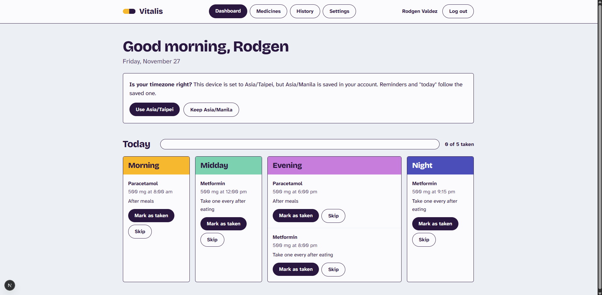
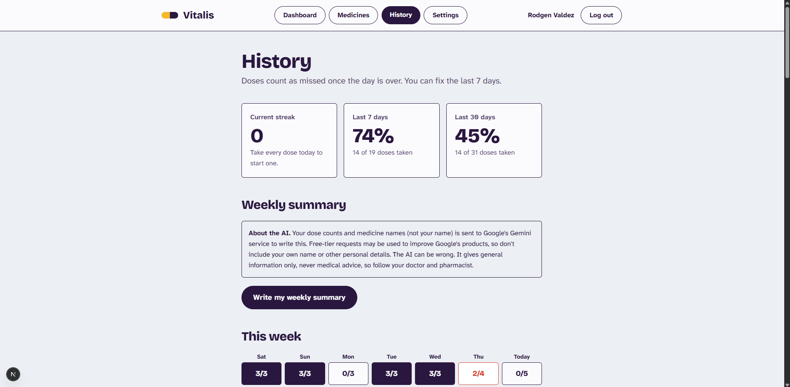
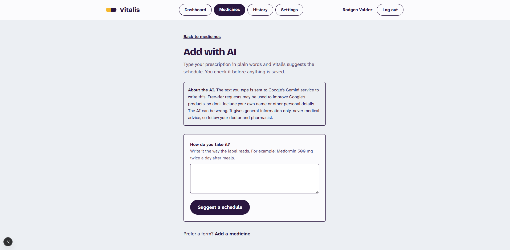
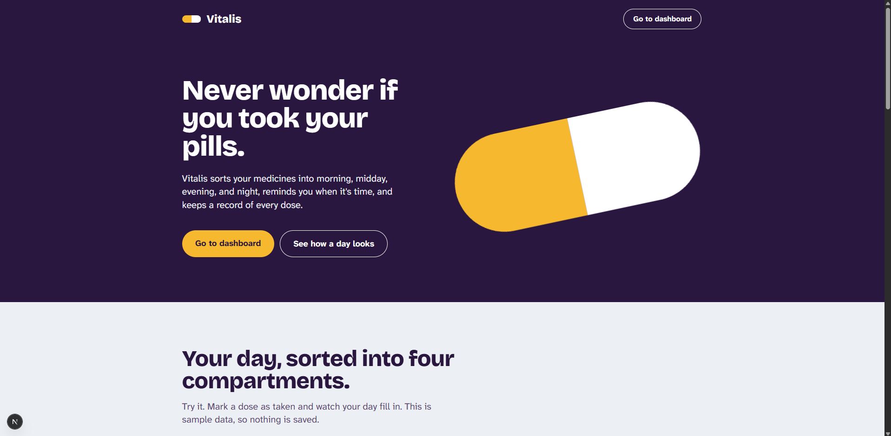
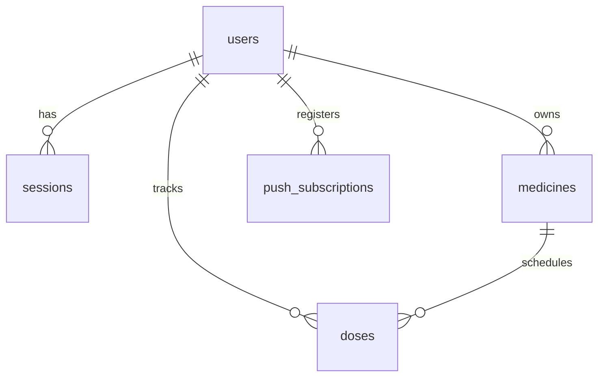

# Vitalis

A medication reminder app: set up your medicines and times, get a reminder when a dose is due, mark doses as taken or skipped, and look back at your history. Optional AI features let you add a medicine by describing it in plain words.

**Live demo:** [https://vitalis-delta-nine.vercel.app/](https://vitalis-delta-nine.vercel.app/) *(replace with your real URL)*

> The demo is public and anyone can sign up. Please don't enter real personal or medical data.

## Screenshots

| Today's doses | History |
|---|---|
|  |  |

| Add medicine with AI | Landing Page |
|---|---|
|  |  |

## Features

- **Authentication:** sign up, log in, and log out with server-side sessions (Better Auth).
- **Medicines:** each medicine has times and days, grouped into morning, midday, evening, and night.
- **Today's dashboard:** see every dose due today and mark it taken or skipped, with undo.
- **Reminders:** browser push notifications sent by a service worker (Web Push).
- **History:** adherence percentage, current streak, per-medicine rates, and the last 7 days at a glance.
- **AI features (Gemini):** add a medicine by typing it in plain words, get information about a medicine, and generate a weekly summary. AI output is always reviewed by the user before anything is saved.
- **Settings:** timezone, hide medicine names in reminders, and delete your account.

### Permissions

| Action | Signed in | Signed out |
|---|:---:|:---:|
| View dashboard and history | ✅ (own data) | ❌ |
| Add, edit, or delete medicines | ✅ (own data) | ❌ |
| Mark doses taken or skipped | ✅ (own data) | ❌ |
| Use AI features | ✅ (own data) | ❌ |
| Receive push reminders | ✅ | ❌ |

Every query and server action is scoped to the signed-in user. Medicine and dose IDs are never trusted on their own, so one account can never read or modify another account's data.

## Tech stack

| Area | Technology |
|---|---|
| Framework | Next.js (App Router), React |
| Language | TypeScript |
| Styling and UI | Tailwind CSS, shadcn/ui, lucide-react, next-themes |
| Database | PostgreSQL (Docker locally, Neon in production) |
| ORM and migrations | Drizzle ORM |
| Validation | Zod |
| Auth | Better Auth |
| Push | Web Push (VAPID), service worker |
| AI | Gemini API |
| Hosting | Vercel (app), Neon (database) |

## Data model



## Design decisions

- **Per-user isolation:** every query and server action is scoped to the signed-in user. Medicine and dose IDs are never trusted on their own, and ownership is checked in the same query, which prevents IDOR bugs.
- **Server-side authorization:** server actions are public endpoints, so each one re-checks the session and ownership, regardless of what the UI shows.
- **Sessions:** handled by Better Auth, with server-side sessions and a secret used to sign them.
- **Push reminders:** a service worker receives Web Push messages and shows the notification. VAPID keys are generated once and kept out of version control.
- **Scheduler:** reminders are triggered by calling `GET /api/cron/send-reminders` with a bearer secret every few minutes. In production a free external scheduler makes that call, because Vercel's free plan only runs cron once a day.
- **AI safety:** AI output is always shown to the user for review before anything is saved. The app gives no medical advice; it is a reminder tool only.
- **Timezone:** stored per user, so doses are grouped into the right morning, midday, evening, and night windows.

## Getting started

### Prerequisites

- Node.js 20.9 or newer
- Docker (for a local PostgreSQL)

### Setup

```bash
git clone https://github.com/RdgnVldz/vitalis.git
cd vitalis
npm install
```

Create a `.env.local` file (see `.env.example`) and fill in the variables listed below.

Start the database, create the tables, and run the app:

```bash
docker compose up -d db
npm run db:push
npm run dev
```

Open [http://localhost:3000](http://localhost:3000).

### Scripts

| Command | What it does |
|---|---|
| `npm run dev` | Start the dev server |
| `npm run build` | Create a production build |
| `npm run lint` | Run ESLint |
| `npm run db:push` | Create the tables from the schema |
| `npm run db:studio` | Open Drizzle Studio to browse the data |

### Environment variables

| Variable | What it is |
|---|---|
| `DATABASE_URL` | Postgres connection string |
| `BETTER_AUTH_SECRET` | Random secret for sessions |
| `BETTER_AUTH_URL` | The address the app runs at |
| `CRON_SECRET` | Secret the reminder scheduler sends |
| `NEXT_PUBLIC_VAPID_PUBLIC_KEY` | Web Push public key |
| `VAPID_PRIVATE_KEY` | Web Push private key |
| `VAPID_SUBJECT` | `mailto:` address for push |
| `GEMINI_API_KEY` | Google AI Studio key |
| `GEMINI_MODEL` | Gemini model name |

Generate VAPID keys with `npx web-push generate-vapid-keys`. Never commit `.env.local`.

## Project structure

```
src/
├── app/
│   ├── (auth)/              # login and signup pages, auth actions
│   ├── dashboard/           # today's doses, taken/skipped/undo
│   ├── medications/         # list, new, edit, schedule, AI add
│   ├── history/             # adherence, streak, per-medicine rates
│   ├── settings/            # timezone, privacy, delete account
│   ├── privacy/             # in-app privacy page
│   └── api/cron/send-reminders/  # reminder scheduler endpoint
├── components/              # shadcn/ui and shared components
├── db/                      # Drizzle schema and client
└── lib/                     # auth, sessions, push, AI, queries
public/
└── sw.js                    # service worker for push reminders
```

## Deployment

The app runs on **Vercel** and the database on **Neon** (PostgreSQL), both on free plans.

1. Create a Neon project and point `DATABASE_URL` at its pooled connection string.
2. Import the repository into Vercel and set the environment variables above.
3. Set up a free external scheduler to call `/api/cron/send-reminders` with `Authorization: Bearer <CRON_SECRET>` every few minutes.
4. Set the Vercel function region close to the database region.

## Safety notes

Vitalis is a reminder tool and gives no medical advice. AI output is always reviewed by the user before anything is saved. See the in-app Privacy page for what is stored and what is sent to Google.

## Roadmap

- [ ] Automated tests (unit, integration, and end-to-end with Playwright)
- [ ] CI/CD with GitHub Actions
- [ ] Email delivery for reminders as an alternative to push
- [ ] Weekly adherence report by email
- [ ] Caregiver access (share a medicine schedule with a family member)
- [ ] Import a medication list from a photo

## Author

Built by **Rodgen Valdez** — [GitHub](https://github.com/RdgnVldz)